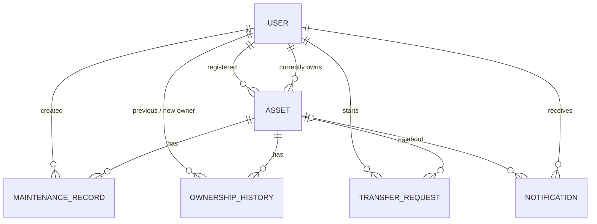

# FixHistory - Database Design

Database: **MongoDB** (default name `fixhistory`), accessed through **Mongoose 8**.
All collections have automatic `createdAt` and `updatedAt` timestamps.

## 1. Entity relationship diagram



Plain-text version:

```
users ─1───*─ assets ─1───*─ maintenancerecords
  │             ├─1───*─ ownershiphistories
  │             ├─1───*─ transferrequests
  │             └─1───*─ notifications
  └─1───*─ notifications
```

## 2. Mapping to the suggested field names

| Suggested in the brief | Implemented as | Reason |
| --- | --- | --- |
| `Asset.userId` | `Asset.currentOwner` (access control) and `Asset.registeredBy` (first owner) | Ownership can change; both facts are needed |
| `Asset.assetId` | `Asset.assetId` | Human-readable unique ID such as `FH-7KQ29XMR` |
| `MaintenanceRecord.assetId` / `userId` | `asset` / `createdBy` (ObjectId references) | Avoids confusion with the human-readable `assetId`; records follow the asset after transfer |
| `TransferRequest.currentOwnerId`, `newOwnerEmail or newOwnerId`, `transferCode` | `currentOwner`, `newOwnerEmail` + `newOwner`, `codeHash` | The code is never stored in plain text |
| `Notification.userId`, `assetId` | `user`, `asset` | Consistent reference naming |
| `MaintenanceRecord.invoice`, `Asset.image` | Sub-document `{ filename, originalName, mimeType, size }` | Keeps the disk name private and records file details |

## 3. Collections

### 3.1 `users`

| Field | Type | Rules |
| --- | --- | --- |
| `_id` | ObjectId | |
| `name` | String | required, 2-60 characters, trimmed |
| `email` | String | required, **unique**, lowercase, valid email format |
| `password` | String | required, bcrypt hash (12 rounds), `select: false` (never returned) |
| `isDemo` | Boolean | `true` for accounts created by the seed script |
| `createdAt`, `updatedAt` | Date | automatic |

Indexes: `{ email: 1 }` unique.

### 3.2 `assets`

| Field | Type | Rules |
| --- | --- | --- |
| `assetId` | String | required, **unique**, uppercase, format `FH-XXXXXXXX` (generated) |
| `currentOwner` | ObjectId → users | required; used for every access check |
| `registeredBy` | ObjectId → users | required |
| `name` | String | required, max 100 |
| `category` | String | required, one of `Vehicle`, `Electronic Device`, `Home Appliance`, `Industrial Equipment`, `Other` |
| `brand` | String | max 60 |
| `model` | String | max 60 |
| `serialNumber` | String | max 80 |
| `purchaseDate` | Date | not in the future |
| `purchasePrice` | Number | ≥ 0 |
| `warrantyStart` | Date | |
| `warrantyExpiry` | Date | ≥ `warrantyStart`; required if `warrantyStart` is set |
| `seller` | String | max 100 |
| `description` | String | max 1000 |
| `image` | File sub-document | optional; JPG/PNG/WEBP ≤ 5 MB |
| `publicPassport.enabled` | Boolean | default `false` |
| `publicPassport.token` | String | random 24-byte token, **unique** |
| `publicPassport.showImage` | Boolean | default `true` |
| `publicPassport.showPurchaseInfo` | Boolean | default `false` |
| `publicPassport.showWarranty` | Boolean | default `true` |
| `publicPassport.showServiceHistory` | Boolean | default `true` |
| `publicPassport.showServiceCosts` | Boolean | default `false` |
| `isSample` | Boolean | `true` for seed data (shown as a "Sample data" badge) |

Indexes: `{ assetId: 1 }` unique, `{ 'publicPassport.token': 1 }` unique,
`{ currentOwner: 1, createdAt: -1 }`, `{ currentOwner: 1, category: 1 }`, `{ currentOwner: 1, warrantyExpiry: 1 }`.

Calculated (not stored): warranty status and remaining days, total maintenance cost, record count,
last and next service date.

### 3.3 `maintenancerecords`

| Field | Type | Rules |
| --- | --- | --- |
| `asset` | ObjectId → assets | required; must be owned by the user creating/editing |
| `createdBy` | ObjectId → users | required |
| `serviceDate` | Date | required, not in the future |
| `serviceType` | String | required, one of `Regular Maintenance`, `Repair`, `Inspection`, `Part Replacement`, `Emergency Service`, `Other` |
| `problemDescription` | String | max 1000 |
| `workPerformed` | String | required, max 2000 |
| `replacedParts` | [String] | up to 30 items, each max 80 |
| `technician` | String | max 80 |
| `serviceProvider` | String | max 100 |
| `cost` | Number | ≥ 0, default 0 |
| `nextServiceDate` | Date | after `serviceDate` |
| `notes` | String | max 1000 |
| `invoice` | File sub-document | optional; PDF/JPG/PNG/WEBP ≤ 5 MB |

Indexes: `{ asset: 1, serviceDate: -1 }`, `{ asset: 1, serviceType: 1 }`.

### 3.4 `ownershiphistories`

| Field | Type | Rules |
| --- | --- | --- |
| `asset` | ObjectId → assets | required, indexed |
| `previousOwner` | ObjectId → users | `null` for the first registration |
| `previousOwnerName` | String | copy of the name at transfer time |
| `newOwner` | ObjectId → users | required |
| `newOwnerName` | String | copy of the name at transfer time |
| `transferDate` | Date | required |
| `transferStatus` | String | `Registered` or `Transferred` |
| `transferRequest` | ObjectId → transferrequests | for transfers |

Names are copied so the history stays readable even if an account is later removed.

### 3.5 `transferrequests`

| Field | Type | Rules |
| --- | --- | --- |
| `asset` | ObjectId → assets | required |
| `currentOwner` | ObjectId → users | required, indexed (the sender) |
| `newOwnerEmail` | String | required, lowercase, indexed |
| `newOwner` | ObjectId → users | set when the transfer completes |
| `codeHash` | String | HMAC-SHA256 of the code, indexed; never returned by the API |
| `message` | String | optional, max 300 |
| `status` | String | `Pending`, `Completed`, `Cancelled`, `Rejected`, `Expired` |
| `expiresAt` | Date | required (default 72 hours) |
| `completedAt`, `closedAt` | Date | |

Indexes: partial **unique** index `{ asset: 1 }` where `status = 'Pending'`
(only one pending transfer per asset), plus `currentOwner`, `newOwnerEmail`, `codeHash`.

### 3.6 `notifications`

| Field | Type | Rules |
| --- | --- | --- |
| `user` | ObjectId → users | required |
| `asset` | ObjectId → assets | optional |
| `type` | String | `SERVICE_DUE`, `WARRANTY_EXPIRY`, `TRANSFER` |
| `key` | String | identifies the event, e.g. `service:<recordId>:2026-11-10` |
| `title` | String | required |
| `message` | String | |
| `reminderDate` | Date | the due date the reminder is about |
| `status` | String | `Pending`, `Completed`, `Dismissed` |
| `resolvedAt` | Date | when completed/dismissed |

Indexes: `{ user: 1, key: 1 }` **unique** (one reminder per event per user), `{ user: 1, status: 1, reminderDate: 1 }`.

## 4. Data integrity rules

- Deleting an asset deletes its maintenance records, ownership history, transfer requests, notifications
  and uploaded files.
- Deleting a record deletes its invoice file.
- Warranty status and reminder labels are calculated from dates on every request, never typed in manually.
- Reminders are regenerated from the latest service record and warranty dates; completed/dismissed
  states are preserved through the unique `key`.
- Every write is validated twice: by Zod in the API and by the Mongoose schema.

## 5. Sample document (asset)

```json
{
  "_id": "6ae5e73e00300ccb19eb1d9a",
  "assetId": "FH-8JW5EUHD",
  "currentOwner": "6ae5e73d00300ccb19eb1d8c",
  "registeredBy": "6ae5e73d00300ccb19eb1d8c",
  "name": "Honda City ZX",
  "category": "Vehicle",
  "brand": "Honda",
  "model": "City ZX i-VTEC CVT",
  "serialNumber": "MAKGN6250PN104578",
  "purchaseDate": "2024-10-01T00:00:00.000Z",
  "purchasePrice": 1325000,
  "warrantyStart": "2024-10-01T00:00:00.000Z",
  "warrantyExpiry": "2027-10-01T00:00:00.000Z",
  "seller": "Sample Motors (demo dealer)",
  "image": null,
  "publicPassport": { "enabled": true, "token": "xUrK5F...", "showImage": true, "showPurchaseInfo": false,
                      "showWarranty": true, "showServiceHistory": true, "showServiceCosts": false },
  "isSample": true,
  "createdAt": "2024-10-01T00:00:00.000Z",
  "updatedAt": "2026-10-31T12:45:10.000Z"
}
```
